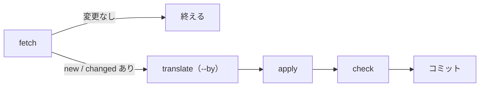

# リリースノートの埋め込み

リリースノートは CORS ヘッダーを返さないので、ブラウザでは取得しない。
この手順で `index.html` の `CLAUDE_NOTES` を書き換え、コミットと push で
反映する（TODO-017）。

Claude Code の CHANGELOG は英語版をブラウザで取得するが、日本語版は無いので、
同じ手順で訳して `CLAUDE_CODE_JA` に埋め込む（TODO-020）。

訳と埋め込みだけの定期のデータ更新なので、TODO 項目は立てず、確認の
担当も分けない。下の「確かめる」を main が行ってコミットする。

取得から確認までを `notes.py run` が続けて行う（TODO-031、TODO-032）。Claude Code の外から
呼ぶのが主な使い方で、この skill もそれを呼ぶだけにする。手元では `~/bin/update-release-notes` に
`notes.py` へのシンボリックリンクを張ってあり、どこからでも呼べる（リポジトリには含まない）。
作業用の JSON はスクラッチパッドに置く。

```bash
.claude/skills/update-release-notes/notes.py run [--by claude|google] <作業用.json>
```

訳し方は `--by` で選ぶ。skill の引数が `google` なら `--by google`、無ければ `--by claude` にする。

| `--by` | 訳すもの | 注意 |
|---|---|---|
| `claude`（既定） | `claude -p` | 利用上限を使う |
| `google` | Google 翻訳の非公式の口（`clients5.google.com`、キー不要） | 予告なく止まることがある。「です・ます」調や識別子の大文字小文字は保証しない |



各段は `fetch` / `translate` / `apply` / `check` のサブコマンドで 1 つずつも流せる。
どの段も、失敗すると何も書かずにエラーで止まる。ただし `run` で `check` が落ちたときは、
`apply` が書いた `index.html` と `last-source.json` が残る。やり直すなら
`git checkout index.html .claude/skills/update-release-notes/last-source.json` で戻してから流す
（戻さないと次の `run` は「変更なし」で終わる）。

## 1. 取得する（fetch）

- リリースノートは英語版（`/docs/en/`）を取る。日本語版は英語版より遅れるので使わない
- リリースノートは同じ日付の見出しをまとめて新しい 3 日分、CHANGELOG は新しい 3 版の
  先頭 8 項目まで（英語版の取得と同じ）を、それぞれ `en` に入れる
- 前回の英語（`last-source.json`）と比べて、日・版ごとに `same` / `changed` / `new` を出す
- 最後の行が「変更なし」なら、何も変えずに終える（片方だけ変わったときは、その片方だけ訳す）
- 3 日分・3 版を読めない、項目が 0 件のものがある、というときはエラーで止まる。元の書式が変わっていないか見る

## 2. 訳す（translate）

`changed` と `new` のものだけ、`en` の 1 項目を `ja` の 1 要素に訳す。`same` のものは今の訳をそのまま使う。
訳し方の決まりは `notes.py` の `RULES` にある（`claude -p` にそのまま渡す）。`google` では、送る前に
Markdown のリンクと `**` を外し、訳した後にバッククォートを外す。

- `title` は `notes.py` が付ける。CHANGELOG の「（日本語）」は、履歴が `title` を
  保存するので英語版と見分けるためのもの
- 訳の数が `en` と合わないものが 1 つでもあれば、何も書かずに止まる

## 3. 書き換える（apply）

`CLAUDE_NOTES` / `CLAUDE_CODE_JA` と、変わった側の上のコメントの日付を書き換え、
`last-source.json` を今回の英語にする。`ja` の数が `en` と合わないと、何も書かずに止まる。

## 4. 確かめる（check）

空いているポートで配信し、`node` から Playwright で次を確かめる。`OK` と出れば済み。

- コンソールにエラーが無い
- 練習文の選択欄に「・YYYY年M月D日の更新」が 3 つ並ぶ
- 選択欄の「・Claude Code 2.1.xxx（英語）」の後に「・Claude Code 2.1.xxx（日本語）」が
  3 つ並び、選ぶと訳が出る
- 「Claudeニュースまとめ」を選ぶと、3 日分が `【タイトル】本文` の形で出る
  （CHANGELOG は含まない）

## 5. コミットする

```
chore(news): リリースノートと CHANGELOG の訳を YYYY-MM-DD 時点に更新する
```

`last-source.json` も一緒にコミットする。片方だけ更新したときは「リリースノートを…」「CHANGELOG の訳を…」とする。

push は利用者が行う。
