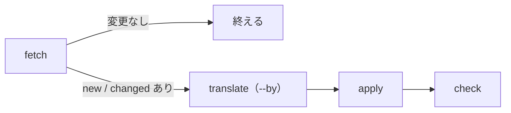

# リリースノートの更新スクリプト

`index.html` には、Claude Platform リリースノートの新しい 3 日分（`CLAUDE_NOTES`）と、
Claude Code の CHANGELOG の最新 3 版（`CLAUDE_CODE_JA`）を、日本語に訳して埋め込んである。
リリースノートは CORS を許していないのでブラウザでは取得できず、CHANGELOG には日本語版が無い。
そこで `.claude/skills/update-release-notes/notes.py` で取得・訳・埋め込み・確認を行い、
コミットと push で反映する。

Claude Code の外からそのまま使える。Claude Code の `/update-release-notes` も、このスクリプトを呼ぶ。

## 必要なもの

- Python 3、curl
- `node` と Playwright（確認に使う。読み込むパスは `notes.py` の `PLAYWRIGHT`）
- `--by claude` で訳すときは `claude` コマンド（Claude Code）

どこからでも呼べるようにするなら、シンボリックリンクを張る。

```bash
ln -s ~/work/jp-long-typing/.claude/skills/update-release-notes/notes.py ~/bin/update-release-notes
```

## 使い方

```bash
notes.py run [--by claude|google] 作業用.json
```

作業用の JSON は、取得した英語と訳を受け渡すための一時ファイルで、どこに置いてもよい
（リポジトリの外がよい）。`index.html` の場所はスクリプトの置き場所から決まるので、
どのディレクトリから呼んでもよい。



`run` は次の 4 段を続けて行う。各段はサブコマンドとして 1 つずつも流せる。

| サブコマンド | すること |
|---|---|
| `fetch 作業用.json` | 英語版を取得し、前回の英語（`last-source.json`）と比べて、日・版ごとに `same` / `changed` / `new` を出す。全部 `same` なら「変更なし」で終える |
| `translate [--by claude\|google] 作業用.json` | `changed` と `new` のものだけ、`en` の 1 項目を `ja` の 1 要素に訳す |
| `apply 作業用.json` | `index.html` の `CLAUDE_NOTES` / `CLAUDE_CODE_JA` と日付のコメントを書き換え、`last-source.json` を今回の英語にする |
| `check` | 空いているポートで `index.html` を配信し、Playwright で表示を確かめる。`OK` と出れば済み |

### 訳し方（`--by`）

| `--by` | 訳すもの | 注意 |
|---|---|---|
| `claude`（既定） | `claude -p` | Claude の利用上限を使う |
| `google` | Google 翻訳の非公式の口（`clients5.google.com`、キー不要） | 予告なく止まることがある。「です・ます」調や、識別子の大文字小文字は保証しない |

訳し方の決まり（です・ます調、Markdown の記法を外す、など）は `notes.py` の `RULES` にあり、
`claude -p` にそのまま渡す。

### check で確かめること

- コンソールにエラーが無い
- 練習文の選択欄に「・YYYY年M月D日の更新」が 3 つ並ぶ
- 「・Claude Code 2.1.xxx（英語）」の後に「・Claude Code 2.1.xxx（日本語）」が 3 つ並び、選ぶと訳が出る
- 「Claudeニュースまとめ」を選ぶと、3 日分が `【タイトル】本文` の形で出る（CHANGELOG は含まない）

## 失敗したとき

どの段も、失敗すると何も書かずにエラーで止まる。

- `fetch` が「3 つ読めない」で止まる: 元の Markdown の書式が変わった可能性がある
- `check` が「コンソールのエラー」で api.rss2json.com の CORS エラーだけを出して落ちる: NHK ニュースの取得の失敗で、内蔵のニュースで動くので表示には問題ない
- `translate` が止まる: 通信エラー、Google の制限、訳の数が英語と合わない、など。`--by` を変えて流し直してよい
- `run` で `check` が落ちたときは、`apply` が書いた `index.html` と `last-source.json` が残る。
  やり直すなら戻してから流す（戻さないと次の `run` は「変更なし」で終わる）

  ```bash
  git checkout index.html .claude/skills/update-release-notes/last-source.json
  ```

## 終わったら

`index.html` と `last-source.json` を一緒にコミットして push する。

```
chore(news): リリースノートと CHANGELOG の訳を YYYY-MM-DD 時点に更新する
```

片方だけ更新したときは「リリースノートを…」「CHANGELOG の訳を…」とする。
