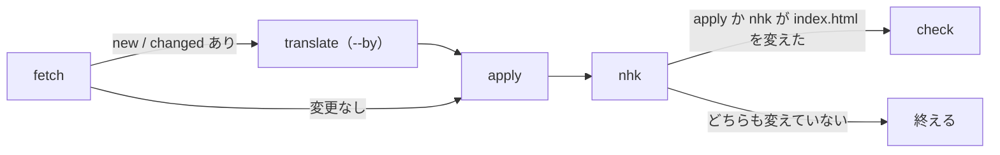
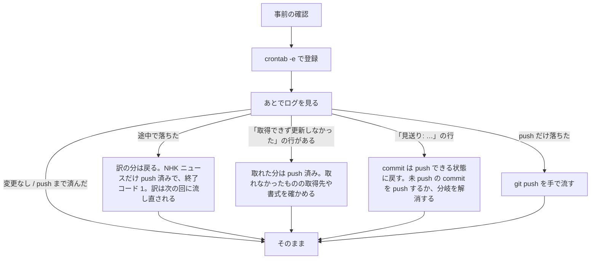

# リリースノートの更新スクリプト

`index.html` には、Claude Platform リリースノートの新しい 3 日分（`CLAUDE_NOTES`）と、
Claude Code の CHANGELOG の最新 3 版（`CLAUDE_CODE_JA`）と、CachyOS ブログの最新 3 件（`CACHYOS_JA`）を、日本語に訳して埋め込んである。
英語の本文もそのまま埋め込む（CachyOS は `CACHYOS_EN`、Claude Code は最新版の先頭 8 項目を `FALLBACK_CLAUDE_CODE`。TODO-041）。
これとは別に、NHK ニュース（`FALLBACK_NHK_NEWS`）も RSS の最新 6 件に書き換える。訳さない（TODO-039）。
ブラウザでは何も取得しない（rss2json は Cloudflare に止められ、リリースノートは CORS を許さず、CHANGELOG には日本語版が無い。TODO-041）。
そこで `.claude/skills/update-release-notes/notes.py` で取得・訳・埋め込み・確認を行い、
コミットと push で反映する。

Claude Code の外からそのまま使える。Claude Code の `/update-release-notes` も、このスクリプトを呼ぶ。

## 必要なもの

- Python 3、curl
- `node` と Playwright（確認に使う。読み込むパスは `notes.py` の `PLAYWRIGHT`）
- `--by claude` で訳すときは `claude` コマンド（Claude Code）

どこからでも呼べるようにするなら、シンボリックリンクを張る。

```bash
ln -s ~/work/jp-long-typing/.claude/skills/update-release-notes/notes.py ~/bin/update-release-notes
```

## 使い方

いつもの更新は、リポジトリ直下の `update-notes.sh` で済む。`run` を流し、
変わっていたら `index.html` と `last-source.json` を「終わったら」のメッセージで commit して push する。
「変更なし」のときは commit しない。`run` が落ちた日は、NHK ニュースの分だけ commit する（下の「失敗したとき」）。

- 始める前に `git fetch` し、master でない・origin より先に進んでいる（未 push の commit がある）・分岐している、のどれかなら、
  ログに理由（`見送り: …`）を出し、何もせず終了コード 0 で終わる。origin より遅れていれば `git merge --ff-only` で取り込む。
  fetch できなかったときは終了コード 1（TODO-041）
- 始める前に `index.html` か `last-source.json` に commit していない変更があると、何もせずに止まる。
  `notes.py run` で `check` が落ちた後に流すときも、先に「失敗したとき」の手順で戻す
- `run` が落ちたとき（translate でも check でも）は、`index.html` と `last-source.json` を HEAD に戻す。
  `google,claude` のように `,` で並べてあれば次の訳し方で流し直し、最後のものも落ちたら、NHK ニュースだけを更新して commit・push し、終了コード 1 で終わる
- push は自分が作った commit の SHA だけを送る（`git push origin <SHA>:refs/heads/master`。HEAD や master はそのまま送らない）。
  push だけ落ちたときは、commit が手元に残って「未 push」になり、次からは見送られる。`git push` を手で流す（TODO-041）

```bash
./update-notes.sh          # claude で訳す
./update-notes.sh google   # Google 翻訳で訳す
./update-notes.sh google,claude   # Google 翻訳で訳し、落ちたら戻して claude で流し直す
```

1 段ずつ流すときや、commit の前に中身を見たいときは `notes.py` を直接使う。

```bash
notes.py run [--by claude|google] 作業用.json
```

作業用の JSON は、取得した英語と訳を受け渡すための一時ファイルで、どこに置いてもよい
（リポジトリの外がよい）。`index.html` の場所はスクリプトの置き場所から決まるので、
どのディレクトリから呼んでもよい。



`run` は次の 5 段を続けて行う（`fetch` が変更なしでも `apply`（配信日時・英語版）と `nhk` は流れる）。各段はサブコマンドとして 1 つずつも流せる。

| サブコマンド | すること |
|---|---|
| `fetch 作業用.json` | 英語版と配信日時を取得し、前回の英語（`last-source.json`）と比べて、日・版・記事ごとに `same` / `changed` / `new` を出す。英語も日時も前と同じなら、その種類は「変更なし」 |
| `translate [--by claude\|google] 作業用.json` | `changed` と `new` のものだけ、`en` の 1 項目を `ja` の 1 要素に訳す |
| `apply 作業用.json` | `index.html` の `CLAUDE_NOTES` / `CLAUDE_CODE_JA` / `FALLBACK_CLAUDE_CODE` / `CACHYOS_JA` / `CACHYOS_EN`（と各記事の `pubDate`）と日付のコメントを書き換え、`last-source.json` を今回の英語にする。訳が無い日も流れ、変わったときだけ `check` に進む |
| `nhk` | NHK の RSS（`cat0.xml`）の最新 6 件（1〜5 件の日はある分）で `FALLBACK_NHK_NEWS` を書き換える。各記事に配信日時 `pubDate`（日本時間の ISO 8601）も持たせ、選択欄のまとめの行に一番新しいものを出す（TODO-040）。`run` は `apply` の後に自動で呼ぶ。取得・解析に失敗したら更新せず、`FALLBACK_NHK_NEWS（NHK ニュース）: 取得できず更新しなかった…` を出す |
| `check` | 空いているポートで `index.html` を配信し、Playwright で表示を確かめる。`OK` と出れば済み |

### 配信日時（`pubDate`）の取り方（TODO-041）

選択欄の各行の末尾に出す日時。日本時間の ISO 8601 で `index.html` の各記事に埋め込む。

| 種類 | 取得元 |
|---|---|
| NHK ニュース・CachyOS ブログ | RSS の `pubDate`（時差の無い日時は日本時間、`-0000` は UTC） |
| Claude Platform リリースノート | 見出しの日付（時刻は無い。選択欄の行は名前に日付が入っているので、日時を付けない） |
| Claude Code（日本語・英語） | GitHub のリリース日時（`api.github.com/repos/anthropics/claude-code/releases` の `published_at`。認証なしで 1 時間に 60 回まで） |

読めない・取れないときは、前に埋め込んだ同じ記事の日時、それも無ければ取得した日時にする。
GitHub のリリース日時が取れなかったときは、ログに `GitHub のリリース日時が取れなかった…` と出るだけで、更新は止めない。

### 訳し方（`--by`）

| `--by` | 訳すもの | 注意 |
|---|---|---|
| `claude`（既定） | `claude -p` | Claude の利用上限を使う |
| `google` | Google 翻訳の非公式の口（`clients5.google.com`、キー不要） | 予告なく止まることがある。「です・ます」調や、識別子の大文字小文字は保証しない |

訳し方の決まり（です・ます調、Markdown の記法を外す、など）は `notes.py` の `RULES` にあり、
`claude -p` にそのまま渡す。

### check で確かめること

- コンソールにエラーが無い。ブラウザが `127.0.0.1` の外へ通信していない（TODO-041）
- 練習文の選択欄に「・YYYY年M月D日の更新」が 3 つ並ぶ（日時は付けない）。Claude Code・CachyOS・NHK の記事ごとの行の末尾の日時は、埋め込んだ `pubDate` を日本時間にしたもの（読めないものは出さない）
- 「・Claude Code 2.1.xxx（英語） (M/D hh:mm)」の後に「・Claude Code 2.1.xxx（日本語） (M/D hh:mm)」が 3 つ並び、選ぶと本文が出る
- 「🐧 CachyOS」の欄に、英語 3 件と「（日本語）」3 件が並び、英語と日本語を 1 件ずつ選ぶと本文の全部が出る
- 「📰 NHK主要ニュースまとめ (N本・M/D hh:mm)」の行が、`FALLBACK_NHK_NEWS` の一番新しい `pubDate` と合い、その下に「・見出し (M/D hh:mm)」が RSS の順に並び、1 つ選ぶと本文が出る
- 「Claudeニュースまとめ」を選ぶと、3 日分が `【タイトル】本文` の形で出る（CHANGELOG は含まない）

## cron で 3 時間ごとに流す

`update-notes.sh google,claude` を cron で 3 時間ごとに流すと、Google 翻訳で訳し（落ちたら claude で流し直し）、
commit と push まで済ませる。crontab への登録は手で行う。



### 1. 事前の確認

```bash
systemctl is-active cronie   # active と出ること
mkdir -p ~/tmp               # ログの置き場所
ssh -T git@github.com        # "successfully authenticated" と出ること
```

- cron には `ssh-agent` が無いので、GitHub への push に使う鍵はパスフレーズの無いものにする
- 手で 1 回流して通るか見ておくとよい（`./update-notes.sh google,claude`。変更があれば commit と push まで進む）

### 2. 登録

`crontab -e` で次の 1 行を足す。毎時 0 分から 3 時間おき（0・3・6…時）に流し、ログを `~/tmp/update-notes.log` に足していく。

```crontab
0 */3 * * * export PATH=$HOME/.local/bin:$HOME/.local/share/mise/shims:/usr/bin:/bin; { date; $HOME/work/jp-long-typing/update-notes.sh google,claude; } >> $HOME/tmp/update-notes.log 2>&1
```

- 時刻は先頭の 2 つ（分 時）で決まる。リポジトリが別の場所にあるときは `$HOME/work/jp-long-typing` を直す
- cron の `PATH` は `/usr/bin:/bin` だけなので、`claude`（`~/.local/bin`）と、mise で入れた `node` の置き場所を足している
- 訳を claude だけにするなら `google,claude` を消す（Claude の利用上限を使う）。`google` だけにすると、落ちた日は更新されない
- 登録できたかは `crontab -l` で見る

### 3. 動いたかの確かめ方

あとで `~/tmp/update-notes.log` を見る。`date` の行が 1 回分の区切り。ログは消さずに伸びるので、ときどき見て消す。

変更が無かった日（最後が「変更なし」）:

```
Sat Oct 24 13:25:05 JST 2026
same     2026年10月22日の更新（2 項目）
same     2026年10月21日の更新（4 項目）
same     2026年10月20日の更新（7 項目）
CLAUDE_NOTES: 変更なし
same     Claude Code 2.1.310（日本語）（8 項目）
same     Claude Code 2.1.309（日本語）（8 項目）
same     Claude Code 2.1.308（日本語）（1 項目）
CLAUDE_CODE_JA: 変更なし
same     CachyOS August 2026 Release（日本語）（50 項目）
same     CachyOS June 2026 Release（日本語）（70 項目）
same     CachyOS April 2026 Release（日本語）（72 項目）
CACHYOS_JA: 変更なし
変更なし
FALLBACK_NHK_NEWS: 変更なし
```

見送った回（未 push の commit がある、分岐している、master でない。終了コードは 0）:

```
Thu Oct 29 03:00:01 JST 2026
見送り: origin/master と未 push のコミットがある（遅れ 0、先行 1）
```

作業中の commit は push してから、cron に任せる（TODO-041）。

`fetch` の最後の「変更なし」は訳の分だけの話で、その後に NHK の行（`最新 6 件に更新した` か `変更なし`）が続く。
NHK はほぼ毎日変わるので、実際は `FALLBACK_NHK_NEWS: 最新 6 件に更新した` と `check` の `OK`、commit と push の行が続く日が多い。

更新した日（`same` の行などは略。最後に commit と push の行が出る）:

```
訳すもの: 2 件 → /tmp/tmp.XXXXXXXXXX.json
2 件を google で訳す
/tmp/tmp.XXXXXXXXXX.json に訳を書いた
index.html と last-source.json を書き換えた（2026-10-24 時点）
OK: 選択欄・訳の表示・まとめ・コンソール
[master f7a6f72] chore(news): リリースノートと CHANGELOG の訳を 2026-10-24 時点に更新する
To github.com:ytani01/jp-long-typing.git
   22b4cc6..f7a6f72  master -> master
```

Google 翻訳が落ちた日は、`Google 翻訳に失敗した（…）` と `claude で流し直す` の後に、claude で同じ流れが続く。

- 途中で落ちたときは `index.html` と `last-source.json` を戻してから止まるので、次の回（3 時間後）にそのまま流し直される。
  何で落ちたかは下の「失敗したとき」を見る
- push だけ落ちた日は、commit が手元に残る。次に変更がある日まで push されないので、`git push` を手で流す

### 4. 止め方

`crontab -e` でその行を消すか、先頭に `#` を付ける。

## CachyOS ブログの取り込み方（TODO-037）

- 新しい順は `https://cachyos.org/rss.xml` の `item` の並びで決め、本文は GitHub の
  `CachyOS/website` の `src/content/post/<slug>.md`（`<slug>` は `link` の `/blog/<slug>/`）から取る
- frontmatter（題名は `title`）、コードブロック、表の行（`|` で始まる行）を除き、
  段落とリストの項目を 1 行ずつ `en` にする（リストの `* ` `- `、見出しの `#`、字下げは外す。見出しの行も `en` に入る）。`<https://…>` は山括弧だけ外して URL を残す
- 日本語版の題名は `title（日本語）`。変わったかの判定・訳・検証は他の 2 つと同じ。英語版の `CACHYOS_EN` は判定によらず、`apply` のたびに `en` から書き直す
- 3 件読めない、frontmatter に `title` が無い、`en` が 0 件、コードブロックが閉じていない、のときは、CachyOS を更新しない（前の内容のまま）
- 対応していない書式: `~~~` のコードブロック、番号付きリスト、画像、HTML、途中で改行した段落（今の記事には無い。出たときは足す）

## 失敗したとき

どの段も、失敗すると何も書かずにエラーで止まる。ただし `fetch` は、リリースノート・CHANGELOG・CachyOS のどれかが
取れない・読めないときは、そのものだけ更新せず前の内容のまま残し、
`<const 名>（<人向けの名前>）: 取得できず更新しなかった。前の内容のまま残す（理由: …）` を 1 行出す
（人向けの名前は リリースノート / CHANGELOG / CachyOS ブログ）。
全部取れないときは終了コード 1 で止まる。取れなかったものは、`update-notes.sh` のコミットメッセージに入らない。
`nhk` は取得・解析に失敗すると、`FALLBACK_NHK_NEWS（NHK ニュース）: 取得できず更新しなかった。前の内容のまま残す（理由: …）` を出して `index.html` に触れない（他の段は止めない）。
RSS が 1〜5 件の日は、ある分だけ埋め込む（0 件は失敗）。

`update-notes.sh` は、ログに「取得できず更新しなかった」の行があれば、取れた分の commit と push を済ませてから終了コード 1 で終わる
（差分が無くて commit しないときも 1）。cron のログで気づける。`/update-release-notes` では、行が出たら利用者に知らせる

- `fetch` が「3 つ読めない」で更新しない: 元の Markdown の書式が変わった可能性がある
- `translate` が止まる: 通信エラー、Google の制限、訳の数が英語と合わない、など。`--by` を変えて流し直してよい
- `notes.py run` を直接流して `check` が落ちたときは、`apply` が書いた `index.html` と `last-source.json` が残る。
  やり直すなら戻してから流す（戻さないと次の `run` は「変更なし」で終わる）

  ```bash
  git checkout index.html .claude/skills/update-release-notes/last-source.json
  ```

`update-notes.sh` は、`run` が落ちた日（取得・訳・`check` の失敗）も、`index.html` と `last-source.json` を戻したあとで
`notes.py nhk` と `check` だけを流し直し、NHK ニュースの更新があれば commit・push する（TODO-039）。
そのときのコミットメッセージは `NHK ニュースを …` だけ。終了コードは 1 のまま。流し直した `check` が落ちたら、NHK も戻す。

## 終わったら

`index.html` と `last-source.json` を一緒にコミットして push する。

```
chore(news): リリースノートと CHANGELOG と CachyOS ブログの訳を YYYY-MM-DD 時点に更新する
```

変わったものだけを「と」でつなぐ（「リリースノート」「CHANGELOG」「CachyOS ブログ」。CachyOS は英語も含むが「訳」でまとめる）。
`update-notes.sh` はログの `CLAUDE_NOTES` / `CLAUDE_CODE_JA` / `CACHYOS_JA` の「変更なし」の行で判定する。

NHK ニュースは訳ではないので、変わったときだけ先頭に付ける。NHK だけなら `chore(news): NHK ニュースを YYYY-MM-DD 時点に更新する`、
他と一緒なら `chore(news): NHK ニュースと、リリースノートの訳を YYYY-MM-DD 時点に更新する`（`FALLBACK_NHK_NEWS` の行で判定）。
